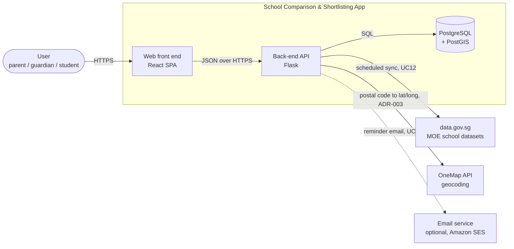
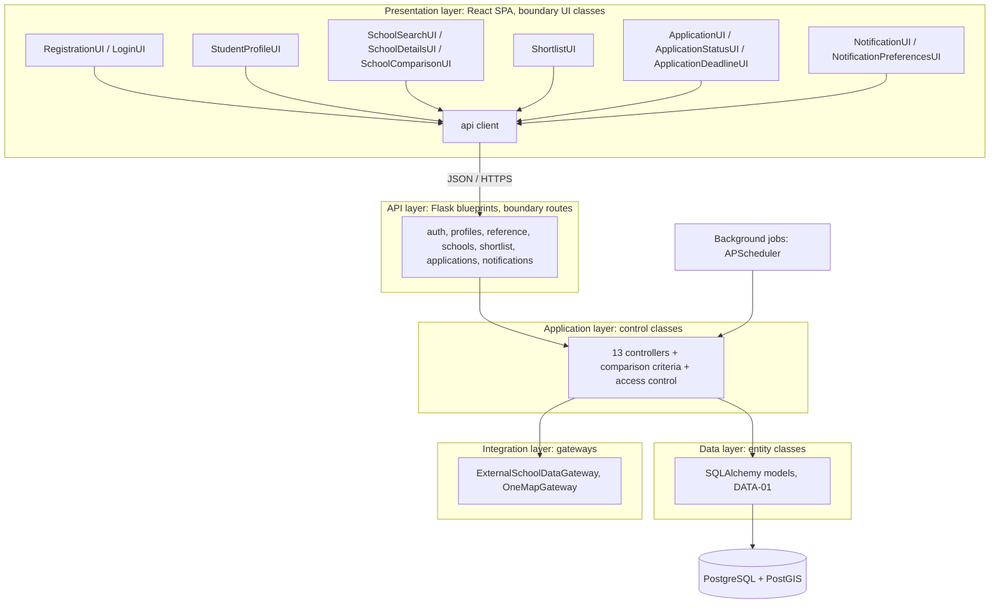
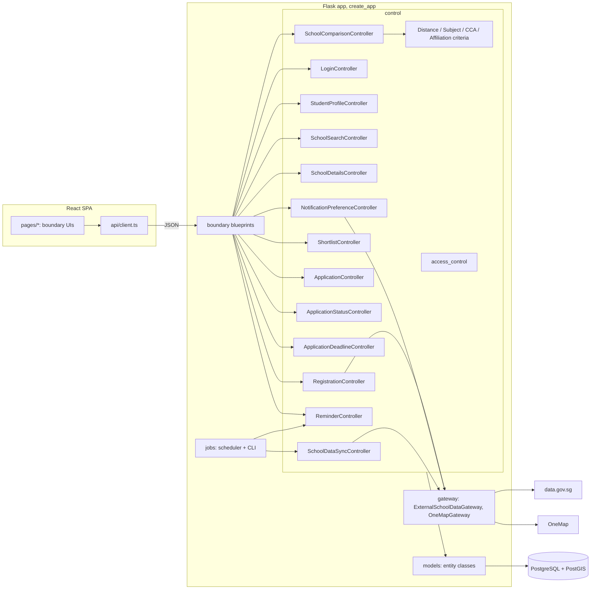
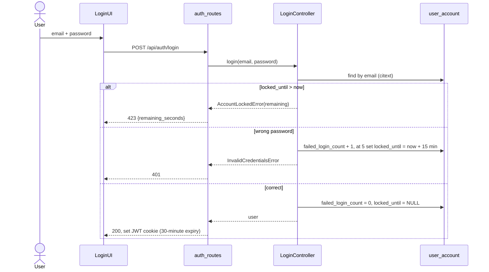
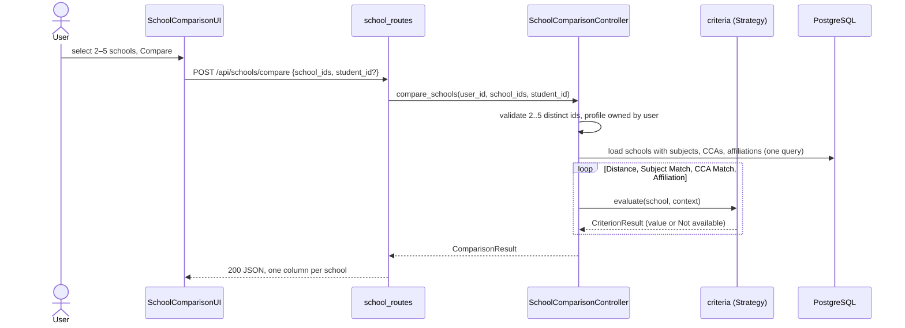
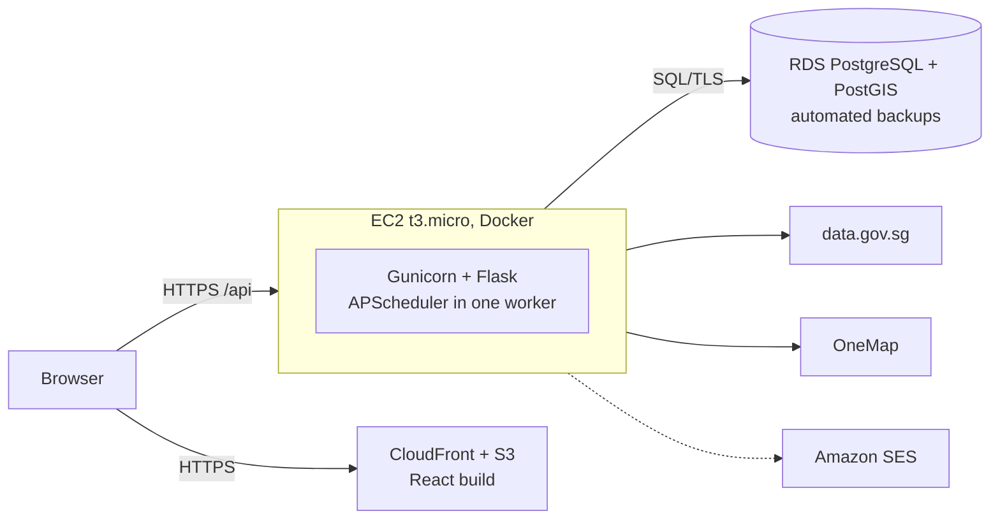

# ARC-02 System Architecture

| Field | Value |
| --- | --- |
| Document ID | ARC-02 |
| Area | 01-App-Architecture |
| Version | 0.1 |
| Status | Draft |
| Last updated | 2026-10-25 |
| Sources | Lab 3 Complete Use Case Model (UC01–UC14); Lab 3 Design Model class diagram (boundary, control, entity classes); Lab 3 dialog map (revised); Lab 2 AI Tech Stack Report; SRS FR 1–12, NFR 3.1–3.5 |
| Depends on | DATA-01 Data Schema v1.0 (all tables, §3.3); ADR-001 to ADR-006 |

## 1. Purpose and scope

This document fixes the overall shape of the School Comparison & Shortlisting App: the system context, the architecture style, the layers and modules, the technology stack, how the key use cases flow through the components, how persistent data and access control are handled, and the design patterns used. Every later Backend (BE-), API (API-) and UI (UI-) document splits its work by the modules named in §3.4.

In scope: the whole release described by the Lab 3 use case model (UC01–UC14), Primary to Junior College schools.
Out of scope: endpoint-level request and response bodies (API- documents), screen layouts (UI- documents), cloud set-up details (OPS-02).

## 2. Requirements covered

| Requirement | Where it is satisfied |
| --- | --- |
| UC01–UC14 (all use cases) | §3.4 module list, §4.1 endpoint map |
| FR 1–2, NFR 3.5.1 (registration, login, 5 failures lock for 15 minutes) | §3.7.2 flow, §3.9 access control |
| NFR 3.5.2 (session ends after 30 minutes inactive) | §3.9.2 sessions |
| NFR 3.5.3 (PDPA handling of personal data) | §3.8 persistent data, §3.9.4 |
| FR 7, NFR 3.3.3 (compare 2–5 schools within 3 s) | §3.7.3 flow, §3.10 Strategy and Facade |
| FR 11 (deadline reminders, daily check) | §3.7.4 background jobs |
| FR 12, NFR 3.2.2 (local synchronised copy, keep working when the source is down) | §3.7.5 school data sync |
| NFR 3.4.1 (standard SQL database) | §3.6 tech stack: PostgreSQL |
| NFR 3.4.2 (containerised deployment) | §3.11 deployment view |
| NFR 3.2.3 (backups) | §3.11 deployment view |
| NFR 3.1.3 (localisation) | §3.6 tech stack: react-i18next |

## 3. Design

### 3.1 System context

The system has one human actor (the User: parent, guardian or student) and three external systems.



*Caption: the app is one web front end, one back-end API and one database; it reads school data from data.gov.sg and coordinates from OneMap.*

### 3.2 Architecture style

**Client–server with a layered, modular monolith back end**, organised by the Boundary–Control–Entity (BCE) stereotypes of the class diagram.

| Option | Pros | Cons |
| --- | --- | --- |
| **Modular monolith, layered BCE (chosen)** | One deployable unit; one place to enforce lockout, session timeout and ownership checks; comparison (UC07) joins School, Subject, CCA and Affiliation in one process, which keeps NFR 3.3.3 within reach; maps one-to-one onto the class diagram | Modules share one database, so boundaries are kept by convention and folder layout |
| Microservices | Independent scaling and deployment | Network calls between services on the comparison path; far more infrastructure than 50 concurrent users need |
| Server-rendered monolith (Flask templates) | One codebase | Lab 2 decision is a separate API-driven front end; harder to keep comparison selection and search context across screens (dialog map §7 items 5–6) |

Rules that follow from the style:

1. The front end never touches the database; it only calls the JSON API (§4.1).
2. Boundary code (API routes) only parses requests, calls one control method, and turns the result into JSON. No business rules.
3. Control classes hold all business rules and coordinate entities. They never read HTTP objects.
4. Entity classes (SQLAlchemy models, DATA-01) hold data and constraints only. No business logic.
5. Only gateway classes talk to external systems.

### 3.3 Layers



*Caption: requests go top-down; each layer only calls the layer below it, and background jobs enter at the control layer like a route would.*

| Layer | Stereotype | Code location | Responsibility |
| --- | --- | --- | --- |
| Presentation | «boundary» UI | `app/frontend/src/pages/` | Screens and UI states from the dialog map; client-side validation; calls the API |
| API | «boundary» route | `app/boundary/` | HTTP: parse, authenticate, call a controller, serialise JSON, map errors to status codes |
| Application | «control» | `app/control/` | Business rules, validation, ownership checks, transactions |
| Data | «entity» | `app/models/` | Tables, columns, constraints (DATA-01) |
| Integration | «boundary» gateway | `app/gateway/` | data.gov.sg and OneMap HTTP calls, retry and timeout |
| Jobs | start-up / scheduler | `app/jobs/` | Daily deadline check (UC11), scheduled school sync (UC12) |

### 3.4 Modules

Each module is one vertical slice through the layers. Later BE-, API- and UI- documents are written one per module.

| Module | Use cases | UI (boundary) | Route file | Control classes | Entities (DATA-01 tables) |
| --- | --- | --- | --- | --- | --- |
| M1 Accounts | UC01, UC02, UC14 | RegistrationUI, LoginUI, NotificationPreferencesUI | `auth_routes.py`, `notification_routes.py` | RegistrationController, LoginController, NotificationPreferenceController | user_account |
| M2 Student profiles | UC03 | StudentProfileUI | `profile_routes.py`, `reference_routes.py` | StudentProfileController | student_profile, student_preferred_subject, student_preferred_cca, subject, cca |
| M3 School discovery | UC04, UC05, UC06 | SchoolSearchUI, SchoolDetailsUI | `school_routes.py` | SchoolSearchController, SchoolDetailsController | school, school_subject, school_cca, affiliation, subject, cca |
| M4 Comparison | UC07, UC07a–d | SchoolComparisonUI | `school_routes.py` | SchoolComparisonController, comparison criteria (§3.10) | school, comparison_criterion, user_account.home_location, student preferences |
| M5 Shortlist | UC08 | ShortlistUI | `shortlist_routes.py` | ShortlistController | shortlist, shortlist_entry |
| M6 Applications | UC09, UC10, UC13 | ApplicationUI, ApplicationStatusUI, ApplicationDeadlineUI | `application_routes.py` | ApplicationController, ApplicationStatusController, ApplicationDeadlineController | application |
| M7 Notifications | UC11 | NotificationUI | `notification_routes.py` | ReminderController | deadline_reminder, application, user_account |
| M8 School data | UC12 | none (system job) | CLI command `flask sync-schools`; `GET /data-freshness` in `reference_routes.py` | SchoolDataSyncController | school and catalogue tables, school_sync_log |

Cross-cutting pieces: `control/access_control.py` (ownership checks, §3.9.3), `errors.py` (domain exceptions, §5), `extensions.py` (shared db, migrate, jwt, scheduler instances).

### 3.5 Component diagram



*Caption: every boundary route calls exactly one controller; only gateways reach external systems; jobs call the same controllers as the routes do.*

### 3.6 Technology stack

| Concern | Choice | Reason |
| --- | --- | --- |
| Front end | React 18 + TypeScript, built with Vite | Lab 2 decision; component model fits stateful screens (search, compare selection, shortlist); typed API client |
| Front-end routing and state | React Router; React context for the active student profile and comparison selection | Dialog map §7 items 2, 5, 6: keep active student and search context across screens |
| Localisation | react-i18next | NFR 3.1.3 |
| Back end | Python 3.12+, Flask 3 with the application factory | Lab 2 decision; small, readable, blueprint-per-module |
| ORM and migrations | Flask-SQLAlchemy (SQLAlchemy 2), Flask-Migrate (Alembic), GeoAlchemy2 | DATA-01 §3.7, ADR-005 |
| Database | PostgreSQL 16 with `postgis` and `citext` | NFR 3.4.1 standard SQL; PostGIS computes distance (UC07a) in SQL; citext for case-insensitive email (FR 1.4) |
| Serialisation and validation | marshmallow | Validates request JSON and shapes responses at the boundary |
| Authentication | Flask-JWT-Extended, JWT in an HttpOnly cookie with CSRF protection | Lab 2 decision; stateless; expiry implements NFR 3.5.2 |
| Password hashing | Werkzeug `generate_password_hash` (scrypt) | Never store plain passwords; `user_account.password_hash` |
| Background jobs | APScheduler (in-process) plus Flask CLI commands | UC11 daily check, UC12 sync; no extra broker needed at this scale |
| HTTP client | requests, with timeout and retry | data.gov.sg and OneMap calls |
| WSGI server | Gunicorn | Production server inside the container |
| Containers | Docker, docker-compose for local (app + PostGIS) | NFR 3.4.2 |
| Hosting | AWS: S3 + CloudFront for the SPA; EC2 t3.micro (Docker) for the API; RDS PostgreSQL; SES for optional email | Lab 2 decision; EC2 rather than Lambda because APScheduler needs a long-running process |
| CI | GitHub Actions: pytest, build the image | Repo is on GitHub |

### 3.7 Key flows

#### 3.7.1 Generic request path

1. A page calls a function in `api/client.ts`, which sends JSON with the auth cookie.
2. The blueprint route checks the JWT (`@jwt_required()`), validates the body with a marshmallow schema, and calls one controller method with the current `user_id`.
3. The controller checks ownership (§3.9.3), applies business rules, reads and writes entities inside one database transaction, and returns plain objects.
4. The route serialises the result to JSON. Domain exceptions are turned into status codes by the error handlers in `errors.py` (§5).

#### 3.7.2 Login with lockout (UC02, NFR 3.5.1)



*Caption: the lockout counter lives on user_account; the controller decides, the route only maps the outcome to 423, 401 or 200.*

#### 3.7.3 Compare schools (UC07, NFR 3.3.3)



*Caption: the controller loads all schools in one query, then asks each of the four criterion strategies for its row; a missing value becomes "Not available" instead of failing the whole comparison.*

#### 3.7.4 Daily deadline reminder (UC11)

1. APScheduler fires `ReminderController.check_deadlines()` once a day at 08:00 Asia/Singapore (also runnable as `flask check-deadlines`).
2. It selects applications whose `deadline` is between today and today + 7 days (partial index `ix_application_deadline`), joined to the owner's `user_account.notification_opt_in = true`.
3. For each, it inserts a `deadline_reminder` row for `(application_id, deadline)`. The unique constraint means a repeat run never reminds twice.
4. The user sees stored reminders through `GET /api/notifications`. If email is enabled (open question Q2), the reminder is also sent through SES.

#### 3.7.5 School data sync (UC12, FR 12, NFR 3.2.2)

1. `flask sync-schools` (and a weekly APScheduler job) calls `SchoolDataSyncController.synchronise_school_data()`.
2. The controller opens a `school_sync_log` row, asks `ExternalSchoolDataGateway` for each MOE dataset, page by page.
3. It validates every record (`validate_school_data`); an empty or invalid response aborts the batch and never deletes existing rows.
4. Valid records are upserted by school name (ADR-001); new or changed postal codes are geocoded through `OneMapGateway` (ADR-003).
5. On success the log row is set to Success with `records_updated`; on failure the transaction is rolled back and the row records Failed with `error_message`. Users keep reading the last good copy, and the UI shows a "last updated" notice from `GET /api/data-freshness`.

### 3.8 Persistent data

| Data | Stored where | Lifetime |
| --- | --- | --- |
| Accounts, profiles, preferences, shortlists, applications, reminders | PostgreSQL, DATA-01 tables | Until the user deletes them (cascade rules in DATA-01) |
| School catalogue (schools, subjects, CCAs, affiliations) | PostgreSQL, synced from data.gov.sg | Replaced by each successful sync; never mass-deleted on an empty response |
| Sync history | `school_sync_log` | Kept; drives the freshness notice |
| Session | JWT in an HttpOnly cookie; nothing stored server-side | 30 minutes from the last request |
| Comparison selection, search criteria | Browser memory (React context) | Until the tab closes; not personal data |
| Secrets (DB URL, JWT key, data.gov.sg key) | Environment variables | Never in code or the repo |

The full schema, constraints and delete rules are in DATA-01 §3.3 and §3.6.

### 3.9 Access control

#### 3.9.1 Who can do what

| Resource | Anonymous | Logged-in user | System job |
| --- | --- | --- | --- |
| Register, log in | ✔ | — | — |
| School search, details, compare, subjects, CCAs | — | ✔ | — |
| Own account, notification preference | — | ✔ (own only) | — |
| Student profiles | — | ✔ (own only) | — |
| Shortlist of a profile | — | ✔ (profiles they own) | — |
| Applications, status, deadline | — | ✔ (profiles they own) | — |
| Notifications | — | ✔ (own only) | create (UC11) |
| School catalogue write | — | — | ✔ (UC12 only) |

There is no administrator role in the use case model, so no route writes the school catalogue. The sync runs only as a CLI command or scheduled job on the server.

#### 3.9.2 Sessions (NFR 3.5.2)

- On login the API sets an access JWT cookie that expires 30 minutes later.
- Every authenticated response refreshes the cookie with a new 30-minute expiry (Flask-JWT-Extended implicit refresh), so the session ends exactly 30 minutes after the last activity.
- An expired token returns 401 `session_expired`; the front end shows DM-80 Session expired.
- Logout clears the cookie.

#### 3.9.3 Ownership checks

`control/access_control.py` provides `require_profile_owner(user_id, student_id)` and `require_application_owner(user_id, application_id)`. Every controller method that takes a `student_id`, `entry_id` or `application_id` calls one of them first. If the resource does not exist, or belongs to another user, it raises `NotFoundError` (404), so the API never reveals other users' records (UC11 alt flow 3).

#### 3.9.4 Personal data (NFR 3.5.3)

- Passwords are stored only as hashes.
- The API never returns `password_hash`, `failed_login_count` or `locked_until`.
- HTTPS only in deployment; cookies are `Secure`, `HttpOnly`, `SameSite=Lax`.
- Deleting an account cascades to its profiles, shortlists, applications and reminders (DATA-01 delete rules).

### 3.10 Design patterns

| Pattern | Where | Why |
| --- | --- | --- |
| Application Factory | `app/app.py: create_app()` (the start-up class, run by `python -m app.run`) | One place to load config, bind extensions, register blueprints and jobs; lets tests create an app with test config |
| Layered BCE / MVC | `boundary/`, `control/`, `models/` | Matches the class diagram stereotypes; keeps business rules out of HTTP code (high cohesion, loose coupling) |
| Facade | `SchoolComparisonController.compare_schools()` | One call hides the four sub-comparisons UC07a–d from the boundary |
| Strategy | `control/comparison_criteria.py`: `ComparisonCriterionStrategy` with `DistanceCriterion`, `SubjectMatchCriterion`, `CcaMatchCriterion`, `AffiliationCriterion` | One class per `comparison_criterion` row; a new criterion is a new class, not a change to the controller |
| State (transition table) | `ApplicationStatusController.ALLOWED_TRANSITIONS` | UC10 alt flow 3: only Draft→Submitted→UnderReview→Offered/Rejected, Offered→Accepted |
| Gateway / Adapter | `gateway/external_school_data_gateway.py`, `gateway/onemap_gateway.py` | Wraps third-party JSON into our own types; the only place with URLs, timeouts and retries; easy to mock in tests |
| Singleton (shared instances) | `extensions.py`: `db`, `migrate`, `jwt`, `scheduler` | One instance per process, bound to the app in the factory |
| Repository (via ORM) | SQLAlchemy session and models | Controllers query through the ORM rather than raw SQL, keeping the database replaceable (NFR 3.4.1) |

### 3.11 Deployment view



*Caption: the SPA is static files on S3, the API is one Docker container on EC2, and the database is managed RDS with automated backups (NFR 3.2.3).*

Locally, `docker-compose` runs the API container and a `postgis/postgis` container; the front end runs with `npm run dev` and proxies `/api` to the API. Details belong in OPS-01 and OPS-02.

### 3.12 Source layout

```
app/                              one Python package; run commands from the repository root
  run.py                          start-up: create_app() and run (python -m app.run)
  app.py                          create_app() application factory; settings from environment variables (loads app/.env)
  __init__.py                     package marker only
  requirements.txt
  extensions.py                   db, migrate, jwt, scheduler
  errors.py                       domain exceptions + JSON error handlers
  models/                         «entity» (DATA-01)
  control/                        «control» one file per controller
    access_control.py
    comparison_criteria.py
  boundary/                       «boundary» flask-smorest blueprints, one per resource group; one MethodView class per URL
  gateway/                        «boundary» external systems
  jobs/                           scheduler set-up and CLI commands
  frontend/                       React + TypeScript SPA
    src/
      api/client.ts               typed calls to §4.1 endpoints
      pages/                      «boundary» one file per UI class
      context/                    active student, comparison selection
      App.tsx                     routes
```

## 4. Interfaces and contracts

### 4.1 Endpoint map

All paths start with `/api`. All bodies are JSON. "Auth" means a valid JWT cookie. Request and response bodies are defined in the API- documents.

| Method and path | Auth | Controller method | UC |
| --- | --- | --- | --- |
| `POST /auth/register` | — | `RegistrationController.register_account` | UC01 |
| `POST /auth/login` | — | `LoginController.login` | UC02 |
| `POST /auth/logout` | ✔ | `LoginController.logout` | UC02 |
| `GET /auth/me` | ✔ | `LoginController.get_current_user` | UC02 |
| `PATCH /users/me` | ✔ | `RegistrationController.update_home_location` | UC07a |
| `GET /users/me/notification-preference` | ✔ | `NotificationPreferenceController.get_preference` | UC14 |
| `PUT /users/me/notification-preference` | ✔ | `NotificationPreferenceController.update_preference` | UC14 |
| `GET /profiles` | ✔ | `StudentProfileController.list_profiles` | UC03 |
| `POST /profiles` | ✔ | `StudentProfileController.create_profile` | UC03 |
| `GET /profiles/<student_id>` | ✔ | `StudentProfileController.get_profile` | UC03 |
| `PUT /profiles/<student_id>` | ✔ | `StudentProfileController.edit_profile` | UC03 |
| `DELETE /profiles/<student_id>` | ✔ | `StudentProfileController.remove_profile` | UC03 |
| `GET /subjects`, `GET /ccas` | ✔ | `SchoolSearchController.list_subjects`, `list_ccas` | UC03, UC05 |
| `GET /schools?q=&level=&zone=&planning_area=&subject_id=&cca_id=` | ✔ | `SchoolSearchController.search_schools` | UC04, UC05 |
| `GET /schools/<school_id>` | ✔ | `SchoolDetailsController.retrieve_school_details` | UC06 |
| `POST /schools/compare` | ✔ | `SchoolComparisonController.compare_schools` | UC07, UC07a–d |
| `GET /data-freshness` | ✔ | `SchoolDataSyncController.get_last_successful_sync` | UC12 (notice) |
| `GET /profiles/<student_id>/shortlist` | ✔ | `ShortlistController.get_shortlist` | UC08 |
| `POST /profiles/<student_id>/shortlist/entries` | ✔ | `ShortlistController.add_school_to_shortlist` | UC08 |
| `DELETE /profiles/<student_id>/shortlist/entries/<entry_id>` | ✔ | `ShortlistController.remove_school_from_shortlist` | UC08 |
| `GET /applications?student_id=` | ✔ | `ApplicationController.list_applications` | UC09 |
| `POST /applications` | ✔ | `ApplicationController.create_application` | UC09 |
| `GET /applications/<application_id>` | ✔ | `ApplicationController.get_application` | UC09, UC10 |
| `PATCH /applications/<application_id>` | ✔ | `ApplicationController.update_application` | UC09 |
| `PATCH /applications/<application_id>/status` | ✔ | `ApplicationStatusController.update_application_status` | UC10 |
| `PUT /applications/<application_id>/deadline` | ✔ | `ApplicationDeadlineController.set_deadline` | UC13 |
| `DELETE /applications/<application_id>/deadline` | ✔ | `ApplicationDeadlineController.clear_deadline` | UC13 |
| `GET /notifications` | ✔ | `ReminderController.list_notifications` | UC11 |
| `PATCH /notifications/<reminder_id>/read` | ✔ | `ReminderController.mark_as_read` | UC11 |

Server-only entry points (no HTTP route): `flask sync-schools` → `SchoolDataSyncController.synchronise_school_data`; `flask check-deadlines` → `ReminderController.check_deadlines`.

### 4.2 Error response format

Every error response has the body `{"error": "<code>", "message": "<text>", "details": {...}}`, where `details` is optional (e.g. field errors, `remaining_seconds`).

## 5. Error handling and edge cases

| Exception (`app/errors.py`) | Status | `error` code | Raised when |
| --- | --- | --- | --- |
| `ValidationError` | 400 | `validation_failed` | Bad input, bad comparison count, invalid date |
| `InvalidCredentialsError` | 401 | `invalid_credentials` | Wrong email or password |
| (JWT expired or missing) | 401 | `session_expired` / `unauthorised` | NFR 3.5.2 |
| `NotFoundError` | 404 | `not_found` | Missing record, or a record owned by another user |
| `ConflictError` | 409 | `conflict` | Duplicate email, duplicate shortlist entry, duplicate application, profile removal blocked, invalid status transition |
| `AccountLockedError` | 423 | `account_locked` | Five failed logins within the lockout rule |
| `ExternalServiceError` | 503 (jobs: logged) | `external_unavailable` | data.gov.sg or OneMap down; reads keep using local data |

Edge cases handled at the architecture level:

- **External source down:** reads never call external systems on the request path, so search, details and compare keep working on the last synced copy.
- **Geocoding failure on registration:** the account is still created; `home_location` stays NULL and distance shows "Not available" (UC07a alt flow 1).
- **Repeated reminder run:** the `deadline_reminder` unique constraint makes the job idempotent.
- **Double-submitted create:** `application (student_id, school_id)` and `shortlist_entry (shortlist_id, school_id)` unique constraints turn a retry into 409, not a duplicate (UC09 alt flow 2).

## 6. Decisions

- Front end, back end, database, auth and hosting follow the Lab 2 AI Tech Stack Report, with one change: the API runs on EC2 instead of Lambda, because APScheduler needs a long-running process (Lab 2 report, "Cloud Architecture").
- ADR-001 to ADR-006 (DATA-01) apply unchanged.
- New decisions in this document that should get ADRs once approved: BCE layering and folder layout (§3.2, §3.12); JWT in an HttpOnly cookie with sliding 30-minute expiry (§3.9.2); 404 for records owned by other users (§3.9.3); Strategy pattern for comparison criteria (§3.10).

## 7. Open questions

| # | Question | Affects |
| --- | --- | --- |
| Q1 | The class diagram's `Notification` has `isRead`; `deadline_reminder` (DATA-01) has no read flag and defaults `channel` to email. Add `is_read boolean default false` in DATA-01 v1.1? Until then `PATCH /notifications/<id>/read` cannot be implemented. | DATA-01, M7 |
| Q2 | UC11 describes in-app reminders only. Is email (SES) wanted at all? | M7, INT-03 |
| Q3 | Distance for UC07a: straight-line PostGIS distance (chosen here) or travel distance from OneMap routing? | M4 |
| Q4 | UC07a alt flow 2 mentions cached historical distances. With straight-line distance computed in SQL, no cache table is needed. Confirm. | M4, DATA-01 |
| Q5 | The class diagram still shows `CCA.achievementLevel`, no `CCACategory.Others`, `User.preferredLocation` and no `StudentProfile.currentYear`. Update the diagram to match DATA-01 v1.0. | Lab 3 class diagram |

## 8. Change log

- 2026-10-25: v0.1 Draft. First version, written for Lab 3 from the Lab 3 use case model, class diagram, dialog map and the Lab 2 tech stack report.
- 2026-10-26: §3.10, §3.12 and the layer table: source moved into one `app/` package at the repository root; `create_app()` in `app/app.py`, with the settings inside it (no `Config` class or `config.py`); run with `python -m app.run` (user request).
- 2026-10-26: §3.12: boundary routes written as `flask.views.MethodView` classes, one per URL, with `jwt_required()` in each class's `decorators` (user request). Paths and status codes in §4.1 unchanged.
- 2026-10-26: §3.12: blueprints are `flask_smorest.Blueprint`, with `@<bp>.route(...)` above each MethodView class, registered through `flask_smorest.Api` (user request). Adds flask-smorest to the stack; its default error body (`code`, `status`) must be replaced by the §4.2 format in `register_error_handlers`.
- 2026-10-26: §4.1: every endpoint uses marshmallow schemas in both directions: `@<bp>.arguments(...)` for request bodies and query strings, `@<bp>.response(...)` for responses (user request). Response schemas match `frontend/src/api/types.ts` and never include secrets (§3.9.4). flask-smorest rejects invalid input with 422; `register_error_handlers` must map it to 400 `validation_failed` (§5).
