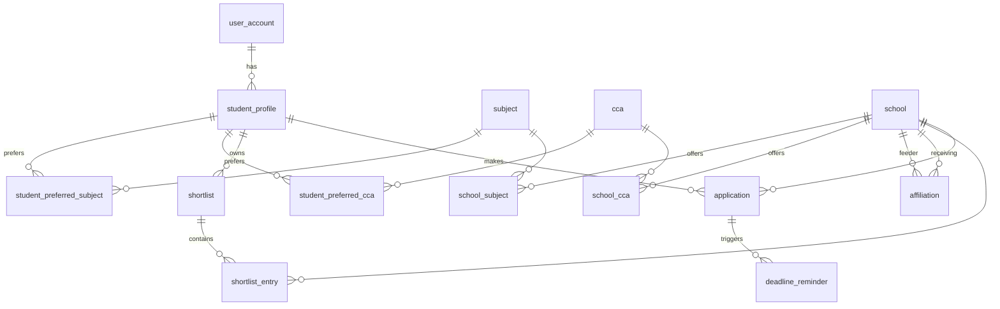

# DATA-01 Data Schema

| Field | Value |
| --- | --- |
| Document ID | DATA-01 |
| Area | 02-Data-Schema |
| Version | 1.0 |
| Status | Approved |
| Last updated | 2026-10-23 |
| Sources | `lab 2/Data Schema/schema.sql`, `lab 2/Data Schema/schema.dbml`; Data Dictionary §3 School, §4 Subject; SRS FR 5.1; Lab 2 Tech Stack Report (Alembic); data.gov.sg dataset `d_688b934f82c1059ed0a6993d2a829089` |
| Depends on | ADR-001 to ADR-006. INT-01 (not yet written) for the OneMap and subject/CCA/affiliation sources |

> v0.1 carried over the Lab 2 schema unchanged. **v0.2 aligns the `school` table and its subjects with the data.gov.sg school dataset** (ADR-001 to ADR-005); every other table is still as in Lab 2. Where the Lab 2 DBML and SQL differ, the SQL is used, because only it states delete rules.

## 1. Purpose and scope

Defines the PostgreSQL database for the School Comparison & Shortlisting App: user accounts and student profiles, the school catalogue (synced from data.gov.sg), subjects, CCAs and affiliations, shortlists, applications and deadline reminders.

Database: PostgreSQL with extensions `citext` (case-insensitive email) and `postgis` (`geography` points, `ST_Distance`).

## 2. Requirements covered

Only the references already annotated in the Lab 2 schema. A full FR/NFR/UC mapping is added once ARC-01 exists.

| Requirement | Satisfied by |
| --- | --- |
| FR 1.4 (unique email) | `user_account.email` UNIQUE, `citext` (§3.3) |
| NFR 3.5.1 (login lockout) | `user_account.failed_login_count`, `locked_until` (§3.3) |
| FR 3.4 (student level) | `student_profile.current_level` (§3.3) |
| FR 5.1 (filter by subject) | index on `school_subject (subject_id)` (§3.4) |
| FR 5.1 (filter by location, programmes) | `school.zone`, `school.planning_area` and their indexes; programme and language subjects (§3.3, §3.8) |
| FR 7.4 (distance) | `school.location`, geocoded on sync (§3.8, ADR-003) |
| UC06 (school details) | `school` classification, contact and transport columns (§3.3) |
| UC12 (school data sync) | field mapping and sync rules (§3.8) |
| FR 9.3 (application notes) | `application.notes` (§3.3) |
| FR 10.5 (one application per school per student) | UNIQUE `application (student_id, school_id)` (§3.3) |
| FR 11.1 (deadline scan) | partial index on `application (deadline)` (§3.4) |
| FR 11.2 (notification opt-in) | `user_account.notification_opt_in` (§3.3) |
| FR 12.5 (sync error logging) | `school_sync_log.error_message` (§3.3) |
| UC13 (deadline tracking) | `application.deadline`; NULL means no reminder (§3.3) |

## 3. Design

### 3.1 ER diagram

Entities and their foreign-key relationships, as defined in the Lab 2 schema.



`school_sync_log` and `comparison_criterion` stand alone (no foreign keys).

### 3.2 Enums

| Enum | Values |
| --- | --- |
| `education_level` | `Primary`, `Secondary`, `JuniorCollege` |
| `school_type` | `Primary`, `Secondary`, `JuniorCollege`, `MixedLevels` |
| `cca_category` | `Sports`, `PerformingArts`, `UniformedGroup`, `ClubSociety`, `Others` (ADR-006) |
| `application_status` | `Draft`, `Submitted`, `UnderReview`, `Offered`, `Rejected`, `Accepted` |
| `sync_status` | `Success`, `Failed`, `Partial` |

### 3.3 Tables

#### Account and profile

**`user_account`**

| Column | Type | Constraints | Notes |
| --- | --- | --- | --- |
| `user_id` | uuid | PK, default `gen_random_uuid()` | |
| `name` | varchar(100) | NOT NULL | |
| `email` | citext | NOT NULL, UNIQUE | FR 1.4 |
| `password_hash` | text | NOT NULL | |
| `failed_login_count` | smallint | NOT NULL, default 0, CHECK `>= 0` | NFR 3.5.1 |
| `locked_until` | timestamptz | | NFR 3.5.1 |
| `preferred_postal_code` | char(6) | | |
| `home_location` | geography(Point, 4326) | | Geocoded from postal code |
| `notification_opt_in` | boolean | NOT NULL, default true | FR 11.2 |
| `created_at` | timestamptz | NOT NULL, default `now()` | |

**`student_profile`**

| Column | Type | Constraints | Notes |
| --- | --- | --- | --- |
| `student_id` | uuid | PK, default `gen_random_uuid()` | |
| `user_id` | uuid | NOT NULL, FK → `user_account` | |
| `name` | varchar(100) | | |
| `current_level` | education_level | NOT NULL | FR 3.4 |
| `current_year` | smallint | NOT NULL, CHECK 1–6 | |
| `created_at` | timestamptz | NOT NULL, default `now()` | |

**`student_preferred_subject`**: PK (`student_id` FK → `student_profile`, `subject_id` FK → `subject`).

**`student_preferred_cca`**: PK (`student_id` FK → `student_profile`, `cca_id` FK → `cca`).

#### School catalogue (synced from data.gov.sg)

**`school`**

| Column | Type | Constraints | Notes |
| --- | --- | --- | --- |
| `school_id` | uuid | PK, default `gen_random_uuid()` | |
| `name` | varchar(150) | NOT NULL, UNIQUE | Sync upsert key (ADR-001) |
| `type` | school_type | NOT NULL | Mapped from `mainlevel_code` (ADR-002) |
| `main_level` | varchar(50) | NOT NULL | Raw `mainlevel_code`, for display |
| `address` | text | NOT NULL | |
| `postal_code` | char(6) | CHECK `~ '^[0-9]{6}$'` | Left-padded to 6 digits |
| `location` | geography(Point, 4326) | | Geocoded from postal code (ADR-003); NULL if lookup failed |
| `zone` | varchar(10) | | `NORTH`, `SOUTH`, `EAST`, `WEST` |
| `planning_area` | varchar(50) | | e.g. `WOODLANDS` |
| `funding_type` | varchar(50) | | e.g. `GOVERNMENT SCHOOL`, `INDEPENDENT SCHOOL` |
| `gender_type` | varchar(20) | | `CO-ED SCHOOL`, `BOYS' SCHOOL`, `GIRLS' SCHOOL` |
| `session_type` | varchar(20) | | `SINGLE SESSION`, `FULL DAY` |
| `website` | text | | |
| `telephone` | varchar(20) | | Main number only |
| `email` | varchar(254) | | |
| `mrt_desc` | text | | Free text as given |
| `bus_desc` | text | | Comma-separated services as given |
| `description` | text | | Not in the dataset; filled by another source or left NULL |
| `is_active` | boolean | NOT NULL, default true | false when missing from a full sync |
| `last_synced_at` | timestamptz | | |

Classification columns hold the dataset's values as given (upper case), so a new value never fails the sync. `moe_code` was removed in v0.2 (ADR-001). Principal and vice-principal names are not stored (ADR-004).

**`subject`**

| Column | Type | Constraints |
| --- | --- | --- |
| `subject_id` | uuid | PK, default `gen_random_uuid()` |
| `subject_name` | varchar(150) | NOT NULL |
| `level` | education_level | NOT NULL |
| `is_special_programme` | boolean | NOT NULL, default false |

UNIQUE (`subject_name`, `level`). Seeded rows for dataset programmes and languages are listed in §3.7.

**`cca`**

| Column | Type | Constraints |
| --- | --- | --- |
| `cca_id` | uuid | PK, default `gen_random_uuid()` |
| `cca_name` | varchar(150) | NOT NULL |
| `category` | cca_category | NOT NULL |

UNIQUE (`cca_name`, `category`).

**`school_subject`**: PK (`school_id` FK → `school`, `subject_id` FK → `subject`).

**`school_cca`**: PK (`school_id` FK → `school`, `cca_id` FK → `cca`).

**`affiliation`**

| Column | Type | Constraints |
| --- | --- | --- |
| `affiliation_id` | uuid | PK, default `gen_random_uuid()` |
| `feeder_school_id` | uuid | NOT NULL, FK → `school` |
| `receiving_school_id` | uuid | NOT NULL, FK → `school` |
| `priority_description` | text | |

UNIQUE (`feeder_school_id`, `receiving_school_id`); CHECK `feeder_school_id <> receiving_school_id`.

**`school_sync_log`**

| Column | Type | Constraints | Notes |
| --- | --- | --- | --- |
| `sync_id` | bigserial | PK | |
| `dataset` | varchar(50) | NOT NULL | |
| `started_at` | timestamptz | NOT NULL, default `now()` | |
| `finished_at` | timestamptz | | |
| `status` | sync_status | NOT NULL | |
| `records_updated` | integer | NOT NULL, default 0 | |
| `error_message` | text | | FR 12.5 |

#### Shortlist and application

**`shortlist`**

| Column | Type | Constraints |
| --- | --- | --- |
| `shortlist_id` | uuid | PK, default `gen_random_uuid()` |
| `student_id` | uuid | NOT NULL, FK → `student_profile` |
| `name` | varchar(100) | NOT NULL, default `'My shortlist'` |
| `date_created` | date | NOT NULL, default `current_date` |
| `notes` | text | |

**`shortlist_entry`**

| Column | Type | Constraints |
| --- | --- | --- |
| `entry_id` | uuid | PK, default `gen_random_uuid()` |
| `shortlist_id` | uuid | NOT NULL, FK → `shortlist` |
| `school_id` | uuid | NOT NULL, FK → `school` |
| `date_added` | date | NOT NULL, default `current_date` |
| `rank` | smallint | CHECK `> 0` |

UNIQUE (`shortlist_id`, `school_id`): no duplicate school in a shortlist.

**`application`**

| Column | Type | Constraints | Notes |
| --- | --- | --- | --- |
| `application_id` | uuid | PK, default `gen_random_uuid()` | |
| `student_id` | uuid | NOT NULL, FK → `student_profile` | |
| `school_id` | uuid | NOT NULL, FK → `school` | |
| `status` | application_status | NOT NULL, default `'Draft'` | |
| `date_submitted` | date | | |
| `deadline` | date | | UC13; NULL = no reminder |
| `notes` | text | | FR 9.3 |
| `updated_at` | timestamptz | NOT NULL, default `now()` | |

UNIQUE (`student_id`, `school_id`) (FR 10.5); CHECK `status = 'Draft' OR date_submitted IS NOT NULL`.

**`deadline_reminder`**

| Column | Type | Constraints |
| --- | --- | --- |
| `reminder_id` | uuid | PK, default `gen_random_uuid()` |
| `application_id` | uuid | NOT NULL, FK → `application` |
| `remind_for_deadline` | date | NOT NULL |
| `channel` | varchar(20) | NOT NULL, default `'email'` |
| `sent_at` | timestamptz | NOT NULL, default `now()` |

UNIQUE (`application_id`, `remind_for_deadline`): never remind twice for the same deadline.

**`comparison_criterion`**: `criterion_id smallint` PK, `criterion_name varchar(50)` NOT NULL UNIQUE. Seeded with 1 Distance, 2 Subject Match, 3 CCA Match, 4 Affiliation.

### 3.4 Indexes

| Table | Index | Purpose |
| --- | --- | --- |
| `student_profile` | (`user_id`) | Profiles by account |
| `school` | GiST (`location`) | Distance queries |
| `school` | (`type`) | Filter by school type |
| `school` | (`zone`) | Filter by zone (FR 5.1) |
| `school` | (`planning_area`) | Filter by planning area (FR 5.1) |
| `school_subject` | (`subject_id`) | Filter by subject (FR 5.1) |
| `school_cca` | (`cca_id`) | Filter by CCA |
| `affiliation` | (`receiving_school_id`) | Affiliations by receiving school |
| `shortlist` | (`student_id`) | Shortlists by student |
| `application` | (`deadline`) WHERE `deadline IS NOT NULL` | Reminder scan (FR 11.1) |

Unique constraints and composite PKs also create indexes (see §3.3).

### 3.5 Delete rules

| Foreign key | On delete |
| --- | --- |
| `student_profile.user_id` → `user_account` | CASCADE |
| `student_preferred_subject.*`, `student_preferred_cca.*` | CASCADE |
| `school_subject.*`, `school_cca.*` | CASCADE |
| `affiliation.feeder_school_id`, `receiving_school_id` → `school` | CASCADE |
| `shortlist.student_id` → `student_profile` | CASCADE |
| `shortlist_entry.shortlist_id` → `shortlist` | CASCADE |
| `shortlist_entry.school_id` → `school` | RESTRICT |
| `application.student_id` → `student_profile` | CASCADE |
| `application.school_id` → `school` | RESTRICT |
| `deadline_reminder.application_id` → `application` | CASCADE |

Schools referenced by shortlists or applications cannot be deleted; they are retired with `is_active = false`.

### 3.6 DDL

The Lab 2 DDL with the v0.2 changes to `school` and the seeded subjects. This is the first Alembic migration (ADR-005).

The same schema in DBML (for dbdiagram.io) is in [`DATA-01-Data-Schema.dbml`](DATA-01-Data-Schema.dbml). This document is the source of truth; the DBML cannot express CHECK constraints, the GiST index or the partial index, so they appear there only as notes.

```sql
CREATE EXTENSION IF NOT EXISTS citext;
CREATE EXTENSION IF NOT EXISTS postgis;   -- geography type, ST_Distance

-- Enums
CREATE TYPE education_level    AS ENUM ('Primary','Secondary','JuniorCollege');
CREATE TYPE school_type        AS ENUM ('Primary','Secondary','JuniorCollege','MixedLevels');
CREATE TYPE cca_category       AS ENUM ('Sports','PerformingArts','UniformedGroup','ClubSociety','Others');
CREATE TYPE application_status AS ENUM ('Draft','Submitted','UnderReview','Offered','Rejected','Accepted');
CREATE TYPE sync_status        AS ENUM ('Success','Failed','Partial');

-- Account and profile
CREATE TABLE user_account (
  user_id               uuid PRIMARY KEY DEFAULT gen_random_uuid(),
  name                  varchar(100) NOT NULL,
  email                 citext       NOT NULL UNIQUE,              -- FR 1.4
  password_hash         text         NOT NULL,
  failed_login_count    smallint     NOT NULL DEFAULT 0 CHECK (failed_login_count >= 0),
  locked_until          timestamptz,                               -- NFR 3.5.1
  preferred_postal_code char(6),
  home_location         geography(Point, 4326),                    -- geocoded from postal code
  notification_opt_in   boolean      NOT NULL DEFAULT true,        -- FR 11.2
  created_at            timestamptz  NOT NULL DEFAULT now()
);

CREATE TABLE student_profile (
  student_id    uuid PRIMARY KEY DEFAULT gen_random_uuid(),
  user_id       uuid NOT NULL REFERENCES user_account ON DELETE CASCADE,
  name          varchar(100),
  current_level education_level NOT NULL,                          -- FR 3.4
  current_year  smallint NOT NULL CHECK (current_year BETWEEN 1 AND 6),
  created_at    timestamptz NOT NULL DEFAULT now()
);
CREATE INDEX ON student_profile (user_id);

-- School catalogue
CREATE TABLE school (
  school_id      uuid PRIMARY KEY DEFAULT gen_random_uuid(),
  name           varchar(150) NOT NULL UNIQUE,                     -- sync upsert key (ADR-001)
  type           school_type  NOT NULL,                            -- mapped from mainlevel_code (ADR-002)
  main_level     varchar(50)  NOT NULL,                            -- raw mainlevel_code
  address        text         NOT NULL,
  postal_code    char(6)      CHECK (postal_code ~ '^[0-9]{6}$'),
  location       geography(Point, 4326),                           -- geocoded via OneMap (ADR-003)
  zone           varchar(10),
  planning_area  varchar(50),
  funding_type   varchar(50),
  gender_type    varchar(20),
  session_type   varchar(20),
  website        text,
  telephone      varchar(20),
  email          varchar(254),
  mrt_desc       text,
  bus_desc       text,
  description    text,
  is_active      boolean     NOT NULL DEFAULT true,
  last_synced_at timestamptz
);
CREATE INDEX ON school USING gist (location);
CREATE INDEX ON school (type);
CREATE INDEX ON school (zone);
CREATE INDEX ON school (planning_area);

CREATE TABLE subject (
  subject_id           uuid PRIMARY KEY DEFAULT gen_random_uuid(),
  subject_name         varchar(150) NOT NULL,
  level                education_level NOT NULL,
  is_special_programme boolean NOT NULL DEFAULT false,
  UNIQUE (subject_name, level)
);

CREATE TABLE cca (
  cca_id   uuid PRIMARY KEY DEFAULT gen_random_uuid(),
  cca_name varchar(150) NOT NULL,
  category cca_category NOT NULL,
  UNIQUE (cca_name, category)
);

CREATE TABLE school_subject (
  school_id  uuid REFERENCES school  ON DELETE CASCADE,
  subject_id uuid REFERENCES subject ON DELETE CASCADE,
  PRIMARY KEY (school_id, subject_id)
);
CREATE INDEX ON school_subject (subject_id);                       -- filter by subject (FR 5.1)

CREATE TABLE school_cca (
  school_id uuid REFERENCES school ON DELETE CASCADE,
  cca_id    uuid REFERENCES cca    ON DELETE CASCADE,
  PRIMARY KEY (school_id, cca_id)
);
CREATE INDEX ON school_cca (cca_id);

CREATE TABLE affiliation (
  affiliation_id       uuid PRIMARY KEY DEFAULT gen_random_uuid(),
  feeder_school_id     uuid NOT NULL REFERENCES school ON DELETE CASCADE,
  receiving_school_id  uuid NOT NULL REFERENCES school ON DELETE CASCADE,
  priority_description text,
  UNIQUE (feeder_school_id, receiving_school_id),
  CHECK (feeder_school_id <> receiving_school_id)
);
CREATE INDEX ON affiliation (receiving_school_id);

CREATE TABLE school_sync_log (
  sync_id         bigserial PRIMARY KEY,
  dataset         varchar(50) NOT NULL,
  started_at      timestamptz NOT NULL DEFAULT now(),
  finished_at     timestamptz,
  status          sync_status NOT NULL,
  records_updated integer NOT NULL DEFAULT 0,
  error_message   text                                             -- FR 12.5
);

-- Student preferences (need subject/cca to exist first)
CREATE TABLE student_preferred_subject (
  student_id uuid REFERENCES student_profile ON DELETE CASCADE,
  subject_id uuid REFERENCES subject         ON DELETE CASCADE,
  PRIMARY KEY (student_id, subject_id)
);
CREATE TABLE student_preferred_cca (
  student_id uuid REFERENCES student_profile ON DELETE CASCADE,
  cca_id     uuid REFERENCES cca             ON DELETE CASCADE,
  PRIMARY KEY (student_id, cca_id)
);

-- Shortlist and application
CREATE TABLE shortlist (
  shortlist_id uuid PRIMARY KEY DEFAULT gen_random_uuid(),
  student_id   uuid NOT NULL REFERENCES student_profile ON DELETE CASCADE,
  name         varchar(100) NOT NULL DEFAULT 'My shortlist',
  date_created date NOT NULL DEFAULT current_date,
  notes        text
);
CREATE INDEX ON shortlist (student_id);

CREATE TABLE shortlist_entry (
  entry_id     uuid PRIMARY KEY DEFAULT gen_random_uuid(),
  shortlist_id uuid NOT NULL REFERENCES shortlist ON DELETE CASCADE,
  school_id    uuid NOT NULL REFERENCES school    ON DELETE RESTRICT,
  date_added   date NOT NULL DEFAULT current_date,
  rank         smallint CHECK (rank > 0),
  UNIQUE (shortlist_id, school_id)                                 -- no duplicate school
);

CREATE TABLE application (
  application_id uuid PRIMARY KEY DEFAULT gen_random_uuid(),
  student_id     uuid NOT NULL REFERENCES student_profile ON DELETE CASCADE,
  school_id      uuid NOT NULL REFERENCES school          ON DELETE RESTRICT,
  status         application_status NOT NULL DEFAULT 'Draft',
  date_submitted date,
  deadline       date,                                             -- UC13; null = no reminder
  notes          text,                                             -- FR 9.3
  updated_at     timestamptz NOT NULL DEFAULT now(),
  UNIQUE (student_id, school_id),                                  -- FR 10.5
  CHECK (status = 'Draft' OR date_submitted IS NOT NULL)
);
CREATE INDEX ON application (deadline) WHERE deadline IS NOT NULL; -- FR 11.1 scan

CREATE TABLE deadline_reminder (
  reminder_id         uuid PRIMARY KEY DEFAULT gen_random_uuid(),
  application_id      uuid NOT NULL REFERENCES application ON DELETE CASCADE,
  remind_for_deadline date NOT NULL,
  channel             varchar(20) NOT NULL DEFAULT 'email',
  sent_at             timestamptz NOT NULL DEFAULT now(),
  UNIQUE (application_id, remind_for_deadline)                     -- never remind twice
);

CREATE TABLE comparison_criterion (
  criterion_id   smallint PRIMARY KEY,
  criterion_name varchar(50) NOT NULL UNIQUE
);
INSERT INTO comparison_criterion VALUES
  (1,'Distance'),(2,'Subject Match'),(3,'CCA Match'),(4,'Affiliation');

-- Programmes and languages derived from the school dataset (ADR-004)
INSERT INTO subject (subject_name, level, is_special_programme)
SELECT s.name, l.level, s.special
FROM (VALUES
  ('Special Assistance Plan (SAP)', true),
  ('Autonomous School',             true),
  ('Gifted Education Programme',    true),
  ('Integrated Programme',          true),
  ('Chinese Language',              false),
  ('Malay Language',                false),
  ('Tamil Language',                false)
) AS s(name, special)
CROSS JOIN unnest(enum_range(NULL::education_level)) AS l(level);
```

### 3.7 Migration and seed approach

- **Tool:** Flask-Migrate (Alembic), as chosen in the Lab 2 Tech Stack Report (ADR-005). Every schema change is a new migration; migrations are never edited once merged.
- **First migration:** the DDL in §3.6, including the seed rows.
- **Seeded in migrations:** `comparison_criterion` (4 rows) and the 21 dataset subjects (7 names × 3 levels).
- **Synced:** `school` and the `school_subject` links to the dataset subjects, by the school data sync (§3.8).
- **Not yet sourced:** other subjects, CCAs (`cca`, `school_cca`) and `affiliation`. Their source is decided in INT-01; until then these tables hold only seeded rows.

### 3.8 School dataset mapping

Source: data.gov.sg `datastore_search`, `resource_id=d_688b934f82c1059ed0a6993d2a829089`, fetched with `limit=1000` (337 records as of 2026-10-23). The sync logs each run in `school_sync_log` with `dataset` set to the resource id.

**Value cleaning, applied to every field:** trim whitespace; the string `na` or an empty string becomes NULL.

| Dataset field | Column | Rule |
| --- | --- | --- |
| `school_name` | `school.name` | Upsert key, as given |
| `mainlevel_code` | `school.main_level`, `school.type` | Raw value stored; type mapped as below |
| `address` | `school.address` | Trimmed |
| `postal_code` | `school.postal_code` | Left-pad with zeros to 6 digits (`88256` → `088256`) |
| `zone_code` | `school.zone` | As given |
| `dgp_code` | `school.planning_area` | As given |
| `type_code` | `school.funding_type` | As given |
| `nature_code` | `school.gender_type` | As given |
| `session_code` | `school.session_type` | As given |
| `url_address` | `school.website` | As given |
| `telephone_no` | `school.telephone` | As given |
| `email_address` | `school.email` | As given |
| `mrt_desc` | `school.mrt_desc` | As given |
| `bus_desc` | `school.bus_desc` | As given |
| `sap_ind` = `Yes` | `school_subject` → Special Assistance Plan (SAP) | Linked at each of the school's levels |
| `autonomous_ind` = `Yes` | `school_subject` → Autonomous School | Same |
| `gifted_ind` = `Yes` | `school_subject` → Gifted Education Programme | Same |
| `ip_ind` = `Yes` | `school_subject` → Integrated Programme | Same |
| `mothertongue1_code` … `3_code` | `school_subject` → `<Value> Language` | e.g. `MALAY` → Malay Language; same levels |
| (none) | `school.location` | Geocoded from `postal_code` via OneMap (ADR-003) |
| `telephone_no_2`, `fax_no`, `fax_no_2` | not stored | ADR-004 |
| `principal_name`, `first_vp_name` … `sixth_vp_name` | not stored | ADR-004 (PDPA) |
| `_id` | not stored | Row number in the dataset, not stable |

**Main level → type and levels:**

| `mainlevel_code` | `school.type` | School's levels (for subject links) |
| --- | --- | --- |
| `PRIMARY` | `Primary` | Primary |
| `SECONDARY (S1-S4)`, `SECONDARY (S1-S5)` | `Secondary` | Secondary |
| `JUNIOR COLLEGE`, `CENTRALISED INSTITUTE` | `JuniorCollege` | JuniorCollege |
| `MIXED LEVEL (P1-S4)` | `MixedLevels` | Primary, Secondary |
| `MIXED LEVEL (S1-JC2)`, `MIXED LEVEL (S1-S5, JC1-JC2)` | `MixedLevels` | Secondary, JuniorCollege |

**Sync rules:**

1. Upsert each record on `school.name`; set `is_active = true` and `last_synced_at = now()`.
2. After a complete fetch, set `is_active = false` for schools not in the dataset. Never delete them (shortlists and applications RESTRICT deletion).
3. For each school, replace its `school_subject` links **to the 21 seeded dataset subjects only**, so links from other sources are untouched.
4. Geocode when `location` is NULL or `postal_code` changed. A failed lookup leaves `location` NULL.
5. A record with an unknown `mainlevel_code`, or that fails a constraint, is skipped and logged; the run's status is `Partial`. A failed or incomplete fetch is `Failed` and changes nothing, including rule 2.

## 4. Interfaces and contracts

Table and column names in §3.3 are the contract for the backend modules (03-Backend). Enum values in §3.2 are the exact strings stored and returned.

## 5. Error handling and edge cases

Handled by the sync rules (§3.8): missing postal-code zeros, `na` values, unknown main levels, failed geocoding, schools removed from the dataset, and incomplete fetches.

Enforced by the database:

- A postal code is exactly six digits.
- Duplicate email (any letter case) is rejected (`citext` UNIQUE).
- A school appears at most once per shortlist, and a student has at most one application per school.
- An application cannot leave `Draft` without a `date_submitted`.
- A reminder is never recorded twice for the same application and deadline.
- A school cannot be deleted while a shortlist entry or application points to it.
- A school cannot be affiliated with itself.

## 6. Decisions

| ADR | Decision |
| --- | --- |
| [ADR-001](../ADR/ADR-001-school-identity-key.md) | Upsert schools on `name`; drop `moe_code` |
| [ADR-002](../ADR/ADR-002-school-type-mapping.md) | Map `mainlevel_code` to four types; keep the raw value |
| [ADR-003](../ADR/ADR-003-school-geocoding.md) | Geocode postal codes via OneMap during sync |
| [ADR-004](../ADR/ADR-004-school-dataset-fields.md) | Which dataset fields to store; programmes and languages as subjects; no staff names |
| [ADR-005](../ADR/ADR-005-migrations-and-seeding.md) | Alembic migrations; subject/CCA/affiliation source deferred to INT-01 |
| [ADR-006](../ADR/ADR-006-cca-category-others.md) | Add `Others` to `cca_category` |

## 7. Open questions

1. **Subject, CCA and affiliation source.** Not in the school dataset; decided in INT-01 (ADR-005). Candidate for CCAs: data.gov.sg `d_9aba12b5527843afb0b2e8e4ed6ac6bd` (7,163 rows; `School_name`, `school_section`, `cca_grouping_desc`, `cca_generic_name`, `cca_customized_name`). Its `cca_generic_name` has an `OTHERS` value with no matching `cca_category`.
2. **"Autonomous School" as a subject.** Stored as a programme subject per ADR-004 so it filters like one, although it is a school status. Revisit if the UI needs it shown separately.
3. **Rest of the schema.** Tables other than `school` and `subject` are still exactly as in Lab 2; they are reviewed against ARC-01 once the Phase 1 conflicts (shortlist cardinality, application statuses) are resolved.

## 8. Change log

- 2026-10-23 (1.0): Approved by the user. Added `Others` to `cca_category` (ADR-006). Open questions in §7 remain and are resolved in INT-01 and after ARC-01.
- 2026-10-23 (0.3): Removed `school_cca.achievement_level` (no source provides it). Noted the data.gov.sg CCA dataset as a candidate source (§7).
- 2026-10-23 (0.2): Aligned with the data.gov.sg school dataset. `school`: removed `moe_code`; added `main_level`, `zone`, `planning_area`, `funding_type`, `gender_type`, `session_type`, `telephone`, `email`, `mrt_desc`, `bus_desc`; postal code CHECK; zone and planning-area indexes. Seeded 21 programme and language subjects. Added migration approach (§3.7) and dataset mapping and sync rules (§3.8). ADR-001 to ADR-005.
- 2026-10-23 (0.1): Created from the Lab 2 schema (`schema.sql`, `schema.dbml`) without changes; open questions from the data.gov.sg school dataset added.
